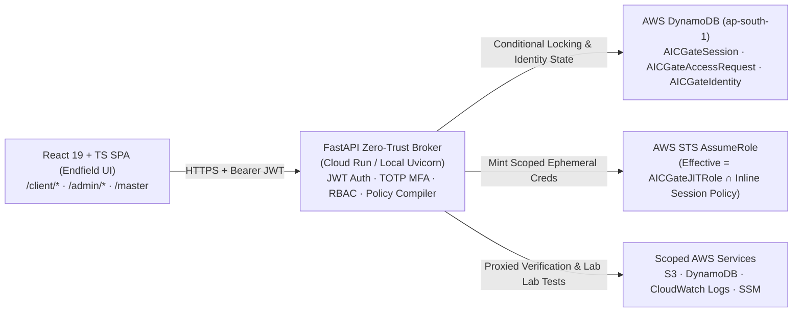

# AIC-GATE — Complete Project Documentation

**Project Name:** AIC-GATE *(Automated Identity Controller & Just-in-Time Cloud Access Gateway)*  
**Version:** v4 (`0.4.0`)  
**Stack:** Python 3.13 + FastAPI · React 19 + TypeScript + Tailwind CSS v4 + Framer Motion · AWS STS / IAM / DynamoDB / S3 / CloudWatch Logs / SSM · Google Cloud Run

---

## 1. Executive Summary & Problem Statement

Traditional cloud setups rely on long-lived IAM users, static `AWS_ACCESS_KEY_ID` pairs, or permanently attached admin roles. When keys leak or an operator moves teams, attackers inherit standing privileges until manual rotation occurs.

**AIC-GATE** enforces **Zero Standing Privileges (ZSP)** across multi-tenant organizations:
1. Operators hold **zero permanent AWS permissions** and never see raw AWS ARNs or IAM policies.
2. Users submit a **scoped Just-in-Time (JIT) access request** (`15–60 min`) from an approved multi-service catalog.
3. Organization Admins review risk-scored requests, inspect the **compiled STS session policy**, and atomically provision time-bounded AWS STS temporary credentials (`AssumeRole` policy intersection).
4. Organizations maintain strict **multi-tenant isolation**, **3-tier admin separation of duties**, custom organization roles, optional **RFC 6238 TOTP MFA**, and full compliance audit trails.

---

## 2. System Architecture

### Hybrid Persistence Architecture
| Table / Store | Key Schema | Contents |
| :--- | :--- | :--- |
| **`AICGateSession`** | `session_id` (String) | Provisioned JIT sessions, service/scope metadata, expiry timestamps, `ACTIVE` / `EXPIRED` / `REVOKED` state |
| **`AICGateAccessRequest`** | `request_id` (String) | Submitted requests, requester attribution (`requester_username`, `requester_display_name`), risk score, atomic claim lock (`CREATING_SESSION`) |
| **`AICGateIdentity`** | `pk` (String) | Single-table store for Organizations (`ORG#`), Users & 1:1 Profiles (`USER#`), Custom Roles (`ROLE#`), Retired/Active Invite Uniqueness Ledger (`INVITE#`), Notifications (`NOTIF#`), and Support Tickets (`TICKET#`). Supports `file` (local dev `.local_data/aic_gate_identity.json`), `memory` (tests), and `dynamodb` (cloud). |

---

## 3. Multi-Service AWS Resource Catalog & Policy Compiler

Requester portals intentionally hide raw AWS buckets, table names, and ARNs using [catalog.py](file:///c:/Users/shrey/OneDrive/Documents/PORT-PROJECTS/AIC-GATE-WORKING/backend/src/aic_gate/catalog.py), preventing reconnaissance while keeping UX intuitive:

| Catalog ID | AWS Service | Client Label | Enforced Least-Privilege Scope | Risk Scoring |
| :--- | :--- | :--- | :--- | :--- |
| `s3-app-logs` | S3 | Application Error Logs (S3) | `s3:GetObject`, `s3:ListBucket` scoped to `logs/*` (`StringLike` prefix condition) | `LOW` / `MEDIUM` / `HIGH` |
| `ddb-session-audit` | DynamoDB | Session Telemetry Table | `GetItem`, `Query`, `Scan`, `DescribeTable` scoped to `AICGateSession` | Escalates on `Scan` or ≥45m TTL |
| `cw-api-logs` | CloudWatch Logs | API Runtime Log Stream | `DescribeLogStreams`, `GetLogEvents`, `FilterLogEvents` on `/aic-gate/app*` | Automated 3-tier score |
| `ssm-app-config` | SSM Parameter Store | Runtime Config Parameters | `GetParameter`, `GetParametersByPath`, `DescribeParameters` on `/aic-gate/config*` | Automated 3-tier score |

- **STS Intersection Guarantee:** Even if an application bug occurred, AWS evaluates `AICGateJITRole ∩ SessionPolicy`, making privilege escalation beyond the intersection mathematically impossible.
- **Multi-Service Scope Tester (`/client/tester`):** [scope_tester.py](file:///c:/Users/shrey/OneDrive/Documents/PORT-PROJECTS/AIC-GATE-WORKING/backend/src/aic_gate/scope_tester.py) verifies active session status, exact service matching, and path traversal bounds across live AWS S3 (`read_session_object`) plus clearly labeled **`LAB SANDBOX`** responders for DynamoDB, CloudWatch Logs, and SSM.

---

## 4. Multi-Tenant RBAC & Separation of Duties

AIC-GATE solves the classic single-admin vs. privilege-creep dilemma with a strict **3-tier administrative hierarchy** ([auth.py](file:///c:/Users/shrey/OneDrive/Documents/PORT-PROJECTS/AIC-GATE-WORKING/backend/src/aic_gate/auth.py), [identity_store.py](file:///c:/Users/shrey/OneDrive/Documents/PORT-PROJECTS/AIC-GATE-WORKING/backend/src/aic_gate/identity_store.py)):

| Capability | `platform_admin` (Master) | `org_owner` (Primary) | `org_admin` (Delegated) | `requester` (Member) |
| :--- | :---: | :---: | :---: | :---: |
| Submit JIT requests & test own sessions | Denied (`403` isolation) | Yes | Yes | Yes |
| Approve/reject JIT requests & provision STS | Denied (`403` isolation) | Yes | Yes | No |
| Approve/reject member signups & assign roles | No (cross-tenant isolated) | Yes | Yes | No |
| Rename Org & rotate non-reusable invite code | Break-glass only | **Yes** | No (`403`) | No |
| Promote/demote Delegated Admins | Yes (incl. Owner recovery) | **Yes** (cannot alter Owner) | No (`403`) | No |
| Manage tenant support tickets & MFA reset | **Yes** | Submits tickets | Submits tickets | No |

- **Zero-Trust Tenant Boundary:** Platform Master handles SaaS tenant governance & break-glass recovery but is server-blocked (`403`) from minting tenant STS keys or reading tenant sessions.
- **Org-Managed Onboarding:** Entering an invite code on Join Org triggers `GET /auth/invite/{code}` to verify the organization and auto-complete the `@allowed_domain` email suffix. Used invite codes are stored permanently in `INVITE#<code>` so retired codes are never reused.

---

## 5. Security Hardening & OWASP Controls

- **Authentication & Optional MFA:** Passwords hashed with `bcrypt`; stateless `HS256` JWTs (`purpose="access"`). Optional RFC 6238 TOTP MFA issues an isolated `purpose="mfa_challenge"` JWT (5-min TTL) that cannot be replayed against API endpoints.
- **Strict Input Validation & Injection Defense ([validation.py](file:///c:/Users/shrey/OneDrive/Documents/PORT-PROJECTS/AIC-GATE-WORKING/backend/src/aic_gate/validation.py)):** Blocks path traversals (`..`, `.`, `//`, `\`), wildcard characters (`*`, `?`), control bytes, duplicate actions, out-of-range durations (`15–60` min), and non-allowlisted buckets/tables/prefixes.
- **IDOR Prevention:** Every `/requests/{id}` and `/sessions/{id}/*` call enforces matching `org_id` plus `user.user_id == record.requester_id` (unless org admin).
- **Safe Custom Avatars:** 1:1 cropped portraits are strictly validated on the backend to allow only built-in `preset:*` tokens or `data:image/(png|jpeg|webp);base64,...` under 200 KB (blocking `svg`, `http(s)://`, and script payloads).
- **Atomic Concurrency Guard:** Provisioning uses DynamoDB `ConditionExpression="#status = :approved"` (`APPROVED → CREATING_SESSION → SESSION_CREATED`), automatically rolling back on STS failure (`release_claimed_request`).
- **Honest Revocation Semantics:** Revoking a session updates `AICGateSession` to `REVOKED` immediately (blocking new credential minting and proxied reads) while candidly informing operators that already-minted AWS STS keys remain valid until their AWS TTL.
- **Secret-Safe Audit Trail & Security Proof:** [audit.py](file:///c:/Users/shrey/OneDrive/Documents/PORT-PROJECTS/AIC-GATE-WORKING/backend/src/aic_gate/audit.py) redacts `secret`, `token`, `password`, and `credential` keys from stdout JSON logs, supports CSV/JSON export, and exposes a live 5-check `POST /admin/security-proof` suite.

---

## 6. Key Frontend Capabilities

- **Arknights: Endfield Industrial UI:** Chamfered panels, corner reticles, Light/Dark theme switcher, Top-Layer native `<dialog>` Notification Drawer (*"While you were away..."* vs live alerts), and visibility-aware background live sync (`useAutoSync`).
- **Interactive Entitlement Graph (`/admin/graph`):** Pan/zoom map canvas with Fullscreen Maximize mode, hover User details card, downstream-only Session → Resource glow & scale, and crisp red `✕` midpoint markers on expired session edges.
- **Endfield Access Key Card Profile (`/client/profile`, `/admin/profile`, `/master/profile`):** 3D cursor-parallax access card with Big-Screen Showcase mode and an interactive **1:1 Square Avatar Cropper**.
- **Custom Role Management (`/admin/roles`):** Color-swatched custom role creation with live preview plus single/bulk member assignment.

---

## 7. Verification Summary

- **Automated Unit Suite (`pytest backend\tests -m "not integration" -v`):** **136 passed, 0 failed**.
- **Live AWS Integration Suite (`pytest backend\tests -m integration -v`):** **3 passed** (verifying live STS `AssumeRole` positive read on `logs/sample.log` vs `AccessDenied` on `restricted/secret.txt`).
- **TypeScript & Vite Build (`npm run build`):** `tsc -b && vite build` **0 errors**.
- **Secret Scanning:** Global `gitleaks` pre-commit hook verifies zero leaked credentials on every commit.

---

## 8. Future Roadmap

1. **Enterprise IdP Federation:** OIDC / SAML 2.0 SSO integration (Okta, Google Workspace, Microsoft Entra ID).
2. **Multi-Account AWS Organizations Broker:** Assume scoped roles across sandbox, staging, and production AWS accounts.
3. **ChatOps Approvals:** Interactive Slack & Microsoft Teams webhook approval cards with one-click revoke.
4. **Terraform / CDK IaC Package:** One-command provisioning of `AICGateJITRole`, DynamoDB tables, and Cloud Run services.
